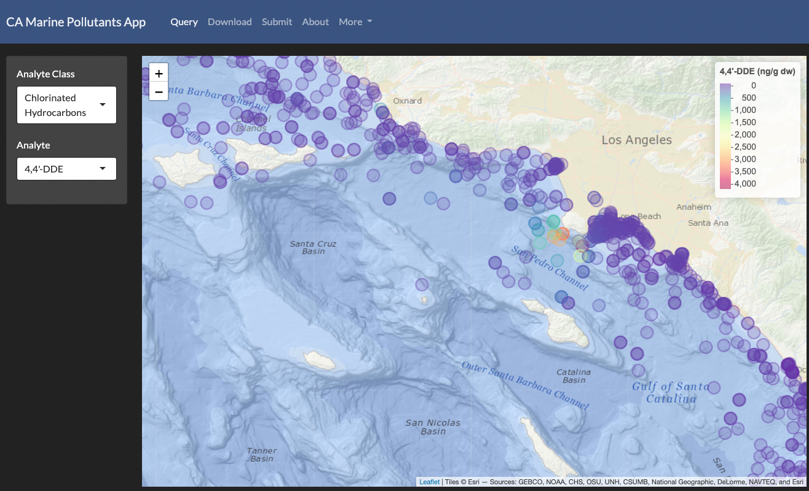

# pollutants-app
Pollutants app (starting with DDT, PFAS, microplastics) with CalCOFI regional partners

- App: [app.calcofi.io/pollutants](https://app.calcofi.io/pollutants/) — the URL carries the analyte class, analyte and map view, so a link reproduces the view (`?theme=dark|light` picks the theme)
  

- Scripts: [calcofi.io/pollutants-app](http://calcofi.io/pollutants-app/)

## html

These web pages (\*.html) are typically rendered from Rmarkdown (\*.Rmd) or Quarto markdown (\*.qmd) :

<!-- Jekyll rendering: https://marineenergy.github.io/apps/ -->

  
* [{{ file.basename }}]({{ site.baseurl }}{{ file.path }})
  


## source

See [github.com/CalCOFI/pollutants-app](https://github.com/CalCOFI/pollutants-app)
